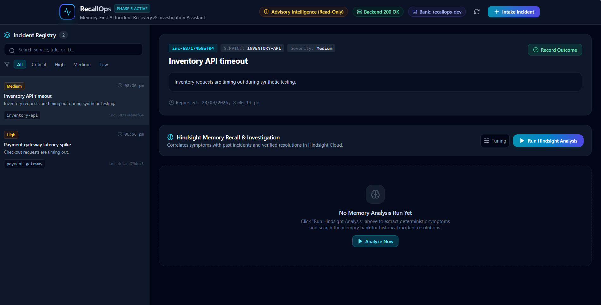
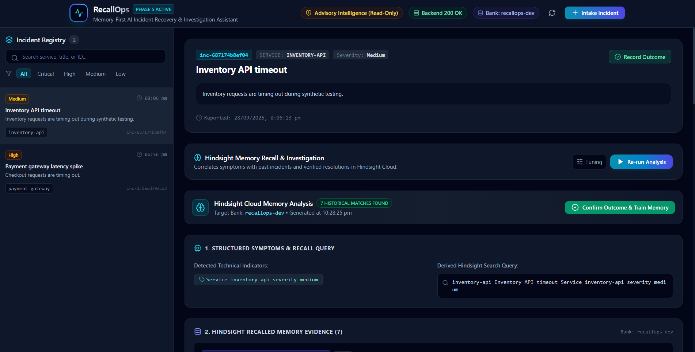
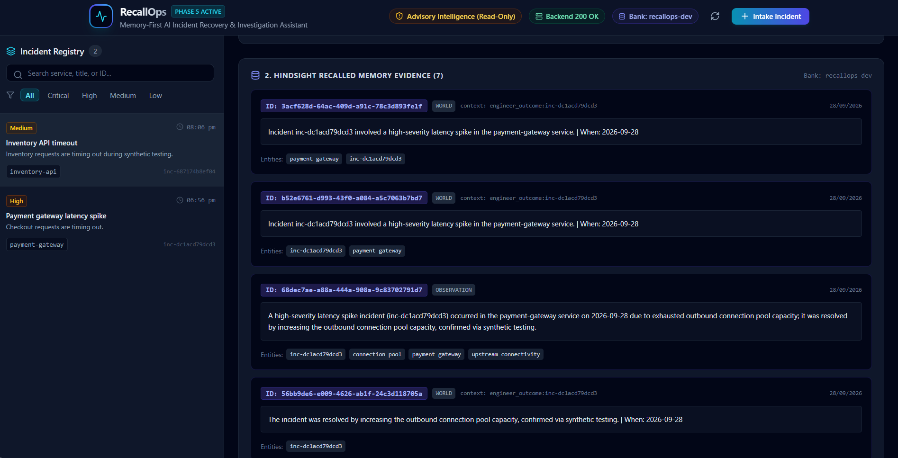
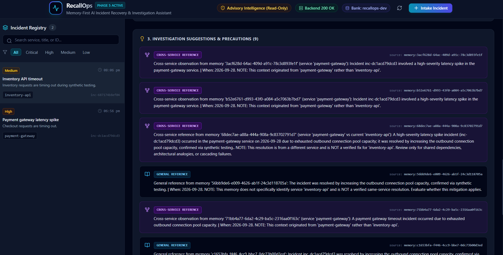
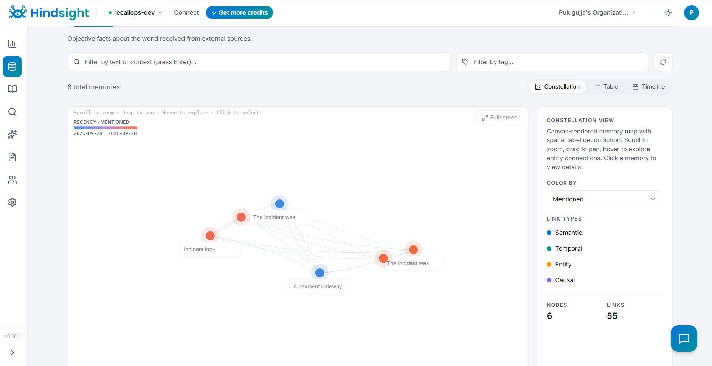

# RecallOps

> **Memory-First AI Incident Investigation and Recovery Assistant**

RecallOps is an operational incident investigation assistant that integrates long-term organizational memory into active outage triage. By connecting directly to a persistent memory bank powered by [Hindsight](https://github.com/vectorize-io/hindsight), RecallOps surfaces past operational observations and resolutions while enforcing deterministic safety boundaries so on-call engineers never confuse an unverified cross-service analogy with a verified same-service fix.

---

## 1. Problem Statement & Motivation

During high-severity production outages, on-call engineers are under intense pressure to restore service quickly. The most valuable asset in these moments is organizational experience:
- *Has this specific timeout pattern occurred before?*
- *Did tuning database connection pools resolve the issue, or did it make things worse?*
- *Which downstream dependencies failed during the last cascade?*

In practice, postmortems and incident notes are archived in wikis, issue trackers, and chat channels—rarely surfaced when an outage is unfolding. When AI assistants are introduced into incident response, they typically suffer from two critical flaws:
1. **Stateless Blank-Slate Queries**: Each investigation begins with a blank prompt, unaware of prior failures or validated mitigations.
2. **The "Relevance Trap"**: Semantic search or generative LLMs frequently suggest fixes from entirely different services (for example, applying a `payment-gateway` connection pool fix to an `inventory-api` worker thread bottleneck) without warning engineers that the mitigation was never verified on the affected architecture.

RecallOps addresses both challenges: it preserves long-term incident memory and enforces strict, deterministic service-relevance classification.

---

## 2. Solution & Workflow

RecallOps implements a deterministic, human-in-the-loop investigation workflow:

```
[ Active Incident Intake ]
           │
           ▼
[ Deterministic Symptom & Signal Extraction ]
   ├── HTTP status codes (e.g., 504)
   ├── Log levels & exceptions (e.g., UpstreamTimeoutException)
   └── Latency metrics & affected service token
           │
           ▼
[ Hindsight Cloud Memory Recall ]
   └── Queries dedicated bank (`recallops-dev`) for past observations & resolutions
           │
           ▼
[ Deterministic Relevance Classifier ]
   ├── Direct Match (same service)
   ├── Cross-Service Reference (different service with explicit precaution)
   └── General Reference (ambiguous or infrastructure-wide context)
           │
           ▼
[ Evidence-Backed Investigation Suggestions ]
   └── Categorized suggestions with memory IDs & raw evidence attribution
           │
           ▼
[ Engineer Verification & Outcome Feedback Loop ]
   ├── Engineer records SUCCESS or FAILURE with attempted actions & notes
   ├── Outcome persisted locally in SQLite
   └── Structured outcome memory retained into Hindsight Cloud
```

### Workflow Steps

1. **Incident Intake**: Engineers log an incident or ingest structured diagnostic traces (title, affected service, severity, description, raw diagnostic logs).
2. **Deterministic Symptom Extraction**: A rule-based parser extracts HTTP status codes, exception names, latency figures, and log levels to build a targeted Hindsight search query.
3. **Hindsight Cloud Memory Recall**: The backend issues an authenticated query to the configured Hindsight Cloud memory bank (`recallops-dev`) to retrieve past factual observations and resolutions.
4. **Deterministic Relevance Classification**: A rule-based classifier evaluates recalled memories against the affected service:
   - **Direct**: Exact match between memory entities/text and the target service.
   - **Cross-Service**: Confirmed match with a different microservice (e.g., `payment-gateway` vs. `inventory-api`).
   - **General**: Ambiguous context or generic infrastructure phrases (`connection pool`, `database`, `upstream connectivity`). Incident IDs and UUIDs are strictly prevented from being misclassified as service names.
5. **Investigation Suggestions & Precaution Banners**: Suggestions are rendered with clear visual badges. Cross-service suggestions display mandatory cautionary notices advising engineers not to apply mitigations directly without verifying shared infrastructure.
6. **Engineer-Confirmed Feedback Loop**: Engineers submit the resolution outcome (`SUCCESS` or `FAILURE`). RecallOps persists the outcome record locally in SQLite and retains a structured memory in Hindsight Cloud, closing the operational learning loop.

---

## 3. Key Features & Safety Limitations

### Key Features
- **Memory-First Triage**: Recalls past operational experiences and resolutions using Hindsight Cloud.
- **Deterministic Signal Parsing**: Regex-based symptom extraction that runs fast, reproducibly, and without requiring an LLM for triage.
- **Microservice Boundary Protection**: Distinguishes same-service fixes from cross-service analogies.
- **Entity Hygiene**: Filters incident IDs (`inc-dc1acd79dcd3`) and infrastructure terms from being misidentified as services.
- **Captures Successes AND Failures**: Preserves failed mitigation attempts so engineers avoid repeating ineffective actions.
- **Full Evidence Attribution**: Every suggestion displays its source memory ID, memory type, context, and entities.

### Safety Limitations
- **Read-Only Advisory Intelligence**: RecallOps **never** executes production commands, restarts containers, or modifies infrastructure.
- **No Autonomous Remediation**: Suggestions are purely advisory. A human engineer must inspect, verify, and execute any changes.
- **Synthetic Demonstration Scope**: The current analysis engine operates on synthetic incident scenarios and test data.
- **No Guaranteed Root Cause**: Historical memories provide operational context and analogies; they do not guarantee root-cause identification for active outages.

---

## 4. Architecture & Technology Stack

| Layer | Technologies | Role |
| :--- | :--- | :--- |
| **Frontend** | React 18, Vite 6, TypeScript 5, Tailwind CSS 3, Lucide React | Single-page advisory dashboard, real-time triage workspace, outcome modal |
| **Backend** | FastAPI, Python 3.10+, Pydantic v2, Pydantic-Settings, Uvicorn, HTTPX | REST API, deterministic symptom extractor, relevance classifier, Hindsight client |
| **Local Storage** | SQLite 3 | Local persistence for incident records, diagnostic logs, and outcome logs |
| **Long-Term Memory** | Hindsight Cloud (`api.hindsight.vectorize.io`) | Dedicated memory bank (`recallops-dev`) storing structured resolution memories |

---

## 5. Project Folder Structure

```
C:\RecallOps\
├── .gitignore                      # Git exclusion rules (.env, *.db, node_modules)
├── README.md                       # Project documentation
├── article.md                      # Architecture deep-dive and implementation article
├── recallops-dashboard.png         # Screenshot: Dashboard & incident registry
├── inventory-api-analysis-1.png    # Screenshot: Symptom extraction & recall query
├── inventory-api-analysis-2.png    # Screenshot: Hindsight recalled memory cards
├── inventory-api-analysis-3.png    # Screenshot: Suggestions & cross-service precautions
├── hindsight-memory-evidence.png   # Screenshot: Hindsight Cloud memory graph
├── backend/
│   ├── .env.example                # Backend environment variable template
│   ├── requirements.txt            # Python dependencies (FastAPI, uvicorn, httpx, pytest)
│   ├── test_hindsight_connection.py# Standalone Hindsight connectivity verification script
│   ├── app/
│   │   ├── __init__.py
│   │   ├── main.py                 # FastAPI application, CORS middleware, health check
│   │   ├── api/
│   │   │   ├── __init__.py
│   │   │   ├── banks.py            # Hindsight bank management and recall endpoints
│   │   │   ├── incidents.py        # Incident CRUD, analysis, and outcome routes
│   │   │   └── schemas.py          # Pydantic request/response schemas
│   │   ├── core/
│   │   │   ├── __init__.py
│   │   │   └── config.py           # Application settings loaded via pydantic-settings
│   │   ├── db/
│   │   │   ├── __init__.py
│   │   │   └── repository.py       # SQLite repository for incidents and outcomes
│   │   └── services/
│   │       ├── __init__.py
│   │       ├── analyzer.py         # Deterministic symptom parser & relevance classifier
│   │       └── hindsight.py        # Asynchronous Hindsight Cloud HTTP client
│   └── tests/
│       ├── test_analysis.py        # Relevance classification & suggestion unit tests
│       ├── test_banks.py           # Bank route and memory recall tests
│       ├── test_health.py          # Basic health check test
│       ├── test_incidents.py       # Incident creation and retrieval tests
│       └── test_outcomes.py        # Outcome recording & rollback tests
└── frontend/
    ├── .env.example                # Frontend environment variable template
    ├── .gitignore                  # Frontend-specific exclusions
    ├── index.html                  # HTML entry point
    ├── package.json                # npm dependencies and build scripts
    ├── package-lock.json           # Locked npm dependencies
    ├── postcss.config.js           # PostCSS configuration
    ├── tailwind.config.js          # Tailwind CSS styling configuration
    ├── tsconfig.json               # TypeScript compiler options
    ├── vite.config.ts              # Vite development and build settings
    └── src/
        ├── App.tsx                 # Root application component
        ├── main.tsx                # React DOM entry point
        ├── index.css               # Global Tailwind CSS styles
        ├── vite-env.d.ts           # Vite client environment types
        ├── components/
        │   ├── Header.tsx          # System health and bank status header
        │   ├── IncidentList.tsx    # Left-hand incident registry list
        │   ├── IncidentDetail.tsx  # Selected incident metadata and log viewer
        │   ├── AnalysisView.tsx    # Three-section analysis viewer with badges
        │   ├── CreateIncidentModal.tsx # New incident intake dialog
        │   └── OutcomeModal.tsx    # Engineer resolution submission dialog
        ├── services/
        │   └── api.ts              # Typed Axios/Fetch API client for backend
        └── types/
            └── api.ts              # TypeScript interfaces matching backend schemas
```

---

## 6. Screenshots & Visual Walkthrough

### Dashboard & Incident Intake Workspace
The RecallOps dashboard displays the active incident registry, real-time backend connection status, and the currently active Hindsight memory bank (`recallops-dev`).


*Figure 1: RecallOps incident recovery dashboard displaying the incident registry, operational health indicators, and active triage workspace.*

---

### Step 1: Symptom Extraction & Query Formulation
When an incident is analyzed, RecallOps deterministically extracts structured signals from raw logs (HTTP codes, exceptions, latency metrics) and constructs a targeted Hindsight query.


*Figure 2: Deterministic symptom extraction and targeted Hindsight query formulation for an active Inventory API incident.*

---

### Step 2: Recalled Historical Evidence
Recalled memory items are returned from Hindsight Cloud, preserving memory IDs, memory types (`WORLD`, `OBSERVATION`), operational timestamps, and extracted entity tags.


*Figure 3: Recalled historical memory evidence retrieved from Hindsight, preserving raw memory IDs, operational contexts, and entity tags.*

---

### Step 3: Investigation Suggestions & Cross-Service Precautions
Suggestions are categorized by relevance. Cross-service matches are marked with prominent purple `CROSS-SERVICE REFERENCE` badges and include explicit warning banners.


*Figure 4: Investigation suggestions with strict relevance classifications, highlighting cross-service references with explicit cautionary disclaimers.*

---

### Persistent Memory Graph (Hindsight Cloud)
Memories retained from past incidents and confirmed resolution outcomes form an associative memory constellation in Hindsight Cloud.


*Figure 5: Hindsight Cloud constellation graph visualizing persistent operational memories, temporal links, and entity relationships in the `recallops-dev` bank.*

---

## 7. Prerequisites & Local Setup Instructions (Windows)

### Prerequisites
- **Operating System**: Windows 10/11
- **Python**: Version 3.10+ (tested with Python 3.13)
- **Node.js**: Version 18+ and `npm`
- **Hindsight Account**: An API key from [Hindsight Cloud](https://hindsight.vectorize.io/)

---

### Step 1: Backend Setup

Open a PowerShell terminal:

```powershell
# Navigate to the backend directory
cd C:\RecallOps\backend

# Create a Python virtual environment
python -m venv .venv

# Activate the virtual environment
.\.venv\Scripts\Activate.ps1

# Upgrade pip and install dependencies
python -m pip install --upgrade pip
pip install -r requirements.txt

# Create your local .env configuration from the template
Copy-Item .env.example .env
```

Open `backend\.env` in an editor and set your configuration:

```env
# Optional LLM integration (not required for deterministic triage)
GROQ_API_KEY=

# Hindsight Cloud credentials
HINDSIGHT_API_KEY=your_hindsight_api_key_here
HINDSIGHT_BASE_URL=https://api.hindsight.vectorize.io
HINDSIGHT_BANK_ID=recallops-dev

# Local SQLite database file path
SQLITE_DB_PATH=recallops.db
```

Verify your Hindsight Cloud connection:

```powershell
python test_hindsight_connection.py
```

*Expected output: `Connectivity check succeeded: Hindsight Cloud is ready.`*

---

### Step 2: Frontend Setup

Open a second PowerShell terminal:

```powershell
# Navigate to the frontend directory
cd C:\RecallOps\frontend

# Create your local .env configuration from the template
Copy-Item .env.example .env

# Install npm dependencies
npm install
```

The default `frontend\.env` connects to the local FastAPI backend:

```env
VITE_API_BASE_URL=http://127.0.0.1:8000
```

---

### Step 3: Running the Application

Keep two terminals open:

#### Terminal 1 — Backend (FastAPI + Uvicorn)
```powershell
cd C:\RecallOps\backend
.\.venv\Scripts\Activate.ps1
uvicorn app.main:app --reload --host 127.0.0.1 --port 8000
```

#### Terminal 2 — Frontend (Vite Dev Server)
```powershell
cd C:\RecallOps\frontend
npm run dev
```

---

### Local Access URLs

| Interface | URL |
| :--- | :--- |
| **RecallOps Web Dashboard** | [http://localhost:5173](http://localhost:5173) |
| **Interactive API Docs (Swagger UI)** | [http://127.0.0.1:8000/docs](http://127.0.0.1:8000/docs) |
| **OpenAPI Specification (JSON)** | [http://127.0.0.1:8000/openapi.json](http://127.0.0.1:8000/openapi.json) |
| **Backend Health Check** | [http://127.0.0.1:8000/health](http://127.0.0.1:8000/health) |

---

## 8. API Endpoint Overview

All API endpoints are prefixed with `/api/v1` (with the exception of `/health`).

### Health Check
- `GET /health`: Returns service health status (`{"status": "ok", "service": "RecallOps"}`).

### Incident Management
- `POST /api/v1/incidents`: Create a new incident (title, description, affected service, severity, logs).
- `GET /api/v1/incidents`: Retrieve paginated incidents (`limit`, `offset`).
- `GET /api/v1/incidents/{incident_id}`: Retrieve full incident details by unique ID.

### Incident Analysis & Recall
- `POST /api/v1/incidents/{incident_id}/analyze`: Deterministically extracts symptoms, queries Hindsight Cloud for matching memories, classifies relevance, and generates structured suggestions and precautions.
  - *Optional payload*: `{"query_override": "custom query", "max_tokens": 1024}`.

### Engineer Outcome & Memory Retention
- `POST /api/v1/incidents/{incident_id}/outcome`: Record engineer resolution outcome (`SUCCESS` or `FAILURE`), resolution action attempted, and notes. Persists to SQLite and retains structured memory in Hindsight Cloud.

### Memory Bank Management
- `GET /api/v1/banks`: List available memory banks in the Hindsight Cloud account.
- `GET /api/v1/banks/default`: Retrieve the currently configured default bank ID (`recallops-dev`).
- `POST /api/v1/banks/{bank_id}/memories`: Directly retain one or more memory items into a bank.
- `POST /api/v1/banks/{bank_id}/memories/recall`: Directly recall memories from a bank with query and token constraints.

---

## 9. Testing & Quality Assurance

The backend includes a comprehensive pytest suite covering symptom extraction, memory relevance classification, incident lifecycle, error handling, and local database rollback on external API failures.

Run the test suite from the backend directory:

```powershell
cd C:\RecallOps\backend
.\.venv\Scripts\Activate.ps1
pytest -v
```

### Current Test Coverage (79 Tests Passing)
- `tests/test_analysis.py` (22 tests): Verifies deterministic symptom extraction, direct vs. cross-service vs. general classification, service token boundary rules, entity hygiene (preventing incident IDs or infrastructure nouns from becoming service names), and suggestion formatting.
- `tests/test_banks.py` (28 tests): Verifies Hindsight bank listing, memory retention payloads, recall requests, and error mapping.
- `tests/test_incidents.py` (17 tests): Verifies incident intake validation, retrieval, and pagination.
- `tests/test_outcomes.py` (11 tests): Verifies outcome recording for `SUCCESS` and `FAILURE`, local DB rollback if Hindsight Cloud encounters authentication/connection errors, and structured memory creation.
- `tests/test_health.py` (1 test): Verifies system health endpoint.

To verify frontend TypeScript compilation and production build:

```powershell
cd C:\RecallOps\frontend
npm run build
```

---

## 10. Limitations & Future Roadmap

### Current Limitations
1. **Deterministic Heuristics**: Symptom extraction currently uses predefined regular expressions. Highly unusual or proprietary stack trace formats may not extract all tokens without explicit rule definitions.
2. **Synthetic Demonstration Data**: Test incident scenarios and historical memories are currently synthetic to ensure reproducibility and privacy.
3. **Single-Node SQLite**: Suitable for local and development environments; production multi-tenant deployments would require a managed relational database (e.g., PostgreSQL).
4. **Static Service Token Patterns**: Service identification currently relies on naming conventions (`-api`, `-gateway`, `-worker`, `-service`) and explicit entity tags rather than a dynamic service mesh topology.

### Future Roadmap
- [ ] **Dynamic Service Mesh Integration**: Ingest live service dependency maps from OpenTelemetry or Kubernetes service registries.
- [ ] **ChatOps & Alerting Ingestion**: Direct webhook integration with PagerDuty, Opsgenie, and Slack channels.
- [ ] **Multi-Bank Hierarchies**: Segregate operational memories by team, environment (staging vs. prod), and microservice domain.
- [ ] **Postmortem Document Sync**: Bi-directional sync with Confluence, Notion, and GitHub Issues to automatically update postmortems with outcome records.

---

## 11. Acknowledgements & References

RecallOps is built on top of [Hindsight](https://github.com/vectorize-io/hindsight), an open-source long-term memory engine for AI agents developed by Vectorize.

- **Hindsight GitHub Repository**: [https://github.com/vectorize-io/hindsight](https://github.com/vectorize-io/hindsight)
- **Hindsight Official Documentation**: [https://hindsight.vectorize.io/](https://hindsight.vectorize.io/)
- **What is Agent Memory? (Vectorize Blog)**: [https://vectorize.io/what-is-agent-memory](https://vectorize.io/what-is-agent-memory)
