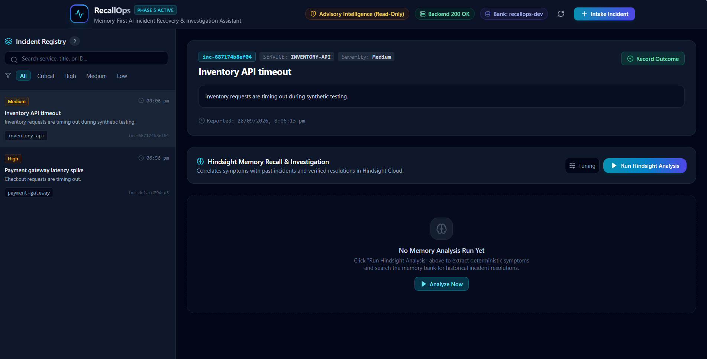
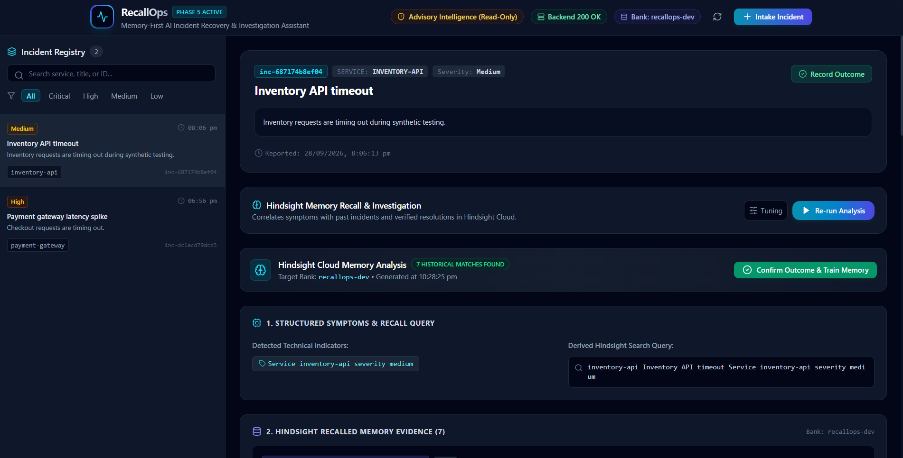
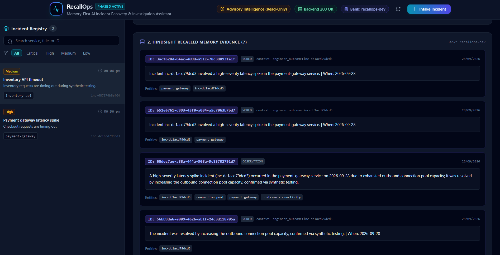
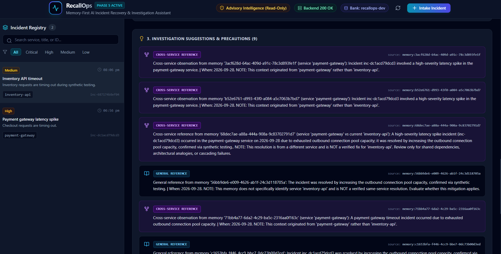
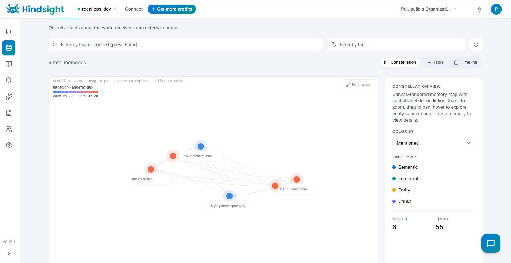

# How I Built an Incident Recovery Assistant That Remembers What Failed

When a critical production service degrades at 2:00 AM, the most valuable asset an on-call engineer can have is organizational memory. Has this database lock contention happened before? Did restarting worker pods resolve the latency spike?

In most teams, postmortems are archived in wikis and rarely surfaced during an active incident. Engineers rely on memory and often repeat mitigations that failed previously.

I built **RecallOps** to retain incident resolutions, recall them in real time, and maintain safety guardrails so engineers never confuse an unverified cross-service analogy with a proven fix.

---

## Persistent Memory for Incident Operations

Most AI-assisted operations tools treat each incident in isolation. Every investigation starts from a blank prompt, disconnected from past operational lessons.

To give RecallOps a persistent memory layer, I integrated [Hindsight](https://github.com/vectorize-io/hindsight), an open-source long-term memory engine for AI agents. As detailed in the [Hindsight documentation](https://hindsight.vectorize.io/) and explored in discussions around [agent memory systems](https://vectorize.io/what-is-agent-memory), effective operational memory requires distinguishing between world knowledge, factual observations, and concrete operational experiences.

RecallOps consists of:
1. **Intake & Local Persistence**: A FastAPI backend backed by SQLite storing incident records, diagnostic logs, and engineer-confirmed outcomes.
2. **Deterministic Analysis Engine**: A rule-based symptom extractor and memory relevance classifier that runs without requiring an LLM for triage.
3. **Long-Term Memory Bank**: A dedicated Hindsight Cloud bank (`recallops-dev`) storing structured resolution memories.
4. **Engineer Dashboard**: A React + Vite + Tailwind CSS dashboard providing real-time triage and confirmation workflows.


*Figure 1: RecallOps incident recovery dashboard displaying the incident registry, operational health indicators, and active triage workspace.*

---

## Step 1: Querying Historical Memory

When an incident is reported, RecallOps deterministically extracts symptoms (such as HTTP error codes, log levels, and exceptions) and constructs a targeted search query. 

To recall matching historical incidents, the backend communicates with Hindsight via a dedicated client service in `backend/app/services/hindsight.py`:

```python
    async def recall_memories(
        self,
        bank_id: Optional[str] = None,
        query: Optional[str] = None,
        types: Optional[list[str]] = None,
        budget: Optional[str] = None,
        max_tokens: Optional[int] = None,
        trace: bool = False,
        query_timestamp: Optional[str] = None,
    ) -> dict[str, Any]:
        """Search (recall) relevant memories from a specified or default memory bank.

        Documented endpoint: POST /v1/default/banks/{bank_id}/memories/recall
        Header: Authorization: Bearer <API_KEY>
        """
        target_bank = self.resolve_bank_id(bank_id)
        clean_query = (query or "").strip()
        if not clean_query:
            raise HindsightError("Query cannot be empty.", status_code=400)

        safe_bank_id = quote(target_bank, safe="")
        endpoint = f"{self.base_url}/v1/default/banks/{safe_bank_id}/memories/recall"

        payload: dict[str, Any] = {"query": clean_query}
        if types is not None:
            payload["types"] = types
        if budget is not None:
            payload["budget"] = budget
        if max_tokens is not None:
            payload["max_tokens"] = max_tokens
        if trace:
            payload["trace"] = trace
        if query_timestamp is not None:
            payload["query_timestamp"] = query_timestamp

        return await self._send_request("POST", endpoint, json_body=payload)
```

This method sends an authenticated `POST` request to the memory bank's `/memories/recall` endpoint, returning past observations and experiences matching the symptom query along with metadata and entity tags.

---

## Step 2: The Relevance Trap (Direct vs. Cross-Service Evidence)

Once memories are returned from Hindsight, a dangerous trap emerges. If an engineer is investigating an outage on `inventory-api`, semantic search might return a similar memory about connection pool exhaustion on `payment-gateway`. 

If the system simply says, *"Past resolution: increase outbound connection pool capacity"*, the engineer might apply that change to `inventory-api`, unaware that the resolution was verified on an entirely different architecture with different dependencies.

To prevent this, I implemented `classify_memory_relevance()` in `backend/app/services/analyzer.py`. The classifier evaluates whether a memory is a **direct** same-service match, a **cross-service** reference, or a **general** ambiguous reference:

```python
def classify_memory_relevance(
    mem: MemoryResult,
    target_service: str,
) -> tuple[str, Optional[str]]:
    """Deterministically classify whether a memory is direct, cross-service, or general relevance.

    Returns:
        tuple[str, Optional[str]]: (classification, detected_service)
        classification is one of: "direct", "cross_service", or "general".
    """
    target_norm = _normalize_service_name(target_service)
    target_spaced = re.sub(r"[-_\s]+", " ", target_norm)

    mem_text = mem.text or ""
    mem_text_lower = mem_text.lower()

    # 1. Direct match check in entities (target matching)
    for ent in (mem.entities or []):
        if _services_match(ent, target_service):
            return "direct", target_norm

    # 2. Direct match check in text (target matching)
    escaped_target = re.escape(target_norm)
    escaped_spaced = re.escape(target_spaced)
    if re.search(rf"\b{escaped_target}\b", mem_text_lower) or re.search(rf"\b{escaped_spaced}\b", mem_text_lower):
        return "direct", target_norm

    # ... (omitted existing code: explicit text service syntax checks) ...

    # 4. Check for known service-like identifiers in entities
    # Never infer cross-service from arbitrary nouns, incident IDs, or infrastructure terms
    for ent in (mem.entities or []):
        if _is_service_identifier(ent):
            norm_ent = _normalize_service_name(ent)
            if not _services_match(norm_ent, target_service):
                return "cross_service", norm_ent

    # ... (omitted existing code: hyphenated service pattern checks in text) ...

    # 6. Default: ambiguous, general infrastructure context, or generic concepts
    return "general", None
```

The classifier uses strict service identifier validation (e.g., matching known suffixes like `-api`, `-gateway`, `-worker`, or `-service`) and filters out incident IDs (`inc-dc1acd79dcd3`) and infrastructure phrases (`connection pool`, `upstream connectivity`). Ambiguous memories default safely to `"general"`.

---

## Step 3: Translating Classifications into Safe Suggestions

Once classified, memories are mapped into structured suggestions in `backend/app/services/analyzer.py`. Each suggestion carries a distinct category, explicit disclaimers, and clear attribution:

```python
            relevance, detected_service = classify_memory_relevance(mem, symptoms.affected_service)

            if relevance == "direct":
                if has_resolution:
                    suggestions.append(
                        AnalysisSuggestion(
                            category="historical_resolution",
                            suggestion=(
                                f"Past resolution from memory '{mem.id}' for '{symptoms.affected_service}': "
                                f"{mem.text.strip()}. "
                                f"Review whether current symptoms match this verified same-service historical context."
                            ),
                            evidence_source=f"memory:{mem.id}",
                        )
                    )
                else:
                    suggestions.append(
                        AnalysisSuggestion(
                            category="historical_observation",
                            suggestion=f"Historical context from memory '{mem.id}' for '{symptoms.affected_service}': {mem.text.strip()}.",
                            evidence_source=f"memory:{mem.id}",
                        )
                    )

            elif relevance == "cross_service":
                other_svc = detected_service or "another service"
                cross_services_detected.add(other_svc)
                if has_resolution:
                    suggestions.append(
                        AnalysisSuggestion(
                            category="cross_service_reference",
                            suggestion=(
                                f"Cross-service reference from memory '{mem.id}' (service '{other_svc}' vs current '{symptoms.affected_service}'): "
                                f"{mem.text.strip()}. "
                                f"NOTE: This resolution is from a different service and is NOT a verified fix for '{symptoms.affected_service}'. "
                                f"Review only for shared dependencies, architectural analogies, or cascading failures."
                            ),
                            evidence_source=f"memory:{mem.id}",
                        )
                    )
                else:
                    suggestions.append(
                        AnalysisSuggestion(
                            category="cross_service_reference",
                            suggestion=(
                                f"Cross-service observation from memory '{mem.id}' (service '{other_svc}'): "
                                f"{mem.text.strip()}. "
                                f"NOTE: This context originated from '{other_svc}' rather than '{symptoms.affected_service}'."
                            ),
                            evidence_source=f"memory:{mem.id}",
                        )
                    )

            else:  # "general"
                if has_resolution:
                    suggestions.append(
                        AnalysisSuggestion(
                            category="general_reference",
                            suggestion=(
                                f"General reference from memory '{mem.id}': {mem.text.strip()}. "
                                f"NOTE: This memory does not specifically identify service '{symptoms.affected_service}' "
                                f"and is NOT a verified same-service resolution. Evaluate whether this mitigation applies."
                            ),
                            evidence_source=f"memory:{mem.id}",
                        )
                    )
                else:
                    suggestions.append(
                        AnalysisSuggestion(
                            category="general_reference",
                            suggestion=(
                                f"General observation from memory '{mem.id}': {mem.text.strip()}. "
                                f"NOTE: This context is general or ambiguous and does not identify service '{symptoms.affected_service}'."
                            ),
                            evidence_source=f"memory:{mem.id}",
                        )
                    )
```

In the dashboard, direct matches appear in emerald badges as verified historical context. Cross-service matches render with prominent purple badges labeled `CROSS-SERVICE REFERENCE` and include mandatory precaution notices.


*Figure 2: Deterministic symptom extraction and targeted Hindsight query formulation for an active Inventory API incident.*


*Figure 3: Recalled historical memory evidence retrieved from Hindsight, preserving raw memory IDs, operational contexts, and entity tags.*


*Figure 4: Investigation suggestions with strict relevance classifications, highlighting cross-service references with explicit cautionary disclaimers.*

---

## Step 4: Closing the Loop (Recording Success and Failure)

When an engineer completes a mitigation, they record the outcome through the dashboard:
- **Status**: Success or Failure.
- **Resolution Attempted**: What action was taken (e.g., *"Scaled replica count from 3 to 6"*).
- **Engineer Notes**: Root cause context and verification steps.

RecallOps stores this outcome locally in SQLite and retains a structured memory in Hindsight. If an engineer records a failed attempt, that failure is preserved. Future triage sessions recall what worked as well as what was proven ineffective.


*Figure 5: Hindsight Cloud constellation graph visualizing persistent operational memories, temporal links, and entity relationships in the `recallops-dev` bank.*

---

## Before and After

### Before RecallOps
An engineer is paged for timeouts on `inventory-api`. Remembering an incident from last week where increasing connection pool limits resolved timeouts on `payment-gateway`, they spend 30 minutes tuning database pool parameters on `inventory-api`. The change has zero impact because the actual bottleneck was thread exhaustion in a worker queue.

### After RecallOps
The engineer opens the `inventory-api` incident in RecallOps and clicks **Analyze Now**. The system queries Hindsight and returns the payment gateway memory, but the relevance engine flags it immediately:
- **Badge**: `CROSS-SERVICE REFERENCE`
- **Notice**: *"NOTE: This resolution is from a different service and is NOT a verified fix for 'inventory-api'. Review only for shared dependencies, architectural analogies, or cascading failures."*
- **Precaution**: *"Cross-service matches detected from: payment-gateway. Do not apply resolutions from other services directly to 'inventory-api' without verifying shared infrastructure..."*

The engineer recognizes that the similarity is an architectural analogy rather than a verified fix, avoids the wrong configuration change, and inspects service-specific worker queues first.

---

## Lessons Learned & System Boundaries

Building RecallOps reinforced several key principles:

1. **Deterministic Logic First**: In the current implementation, symptom extraction and relevance classification are entirely deterministic. Using regex patterns and service token normalizers keeps triage fast, transparent, and reproducible without requiring an LLM.
2. **Entity Hygiene is Critical**: Generic terms like `"connection pool"`, `"database"`, or incident IDs like `"inc-dc1acd79dcd3"` can easily contaminate memory entities. Explicit guards prevent generic phrases from being misidentified as microservice names.
3. **Safety Guardrails Over Automation**: RecallOps deliberately **does not** execute production commands, does not restart infrastructure, and does not automatically close incidents. All test scenarios and demonstration data are synthetic. An incident recovery assistant should inform human decision-making, not replace engineering verification.

By combining long-term memory retrieval with strict relevance classification, we can preserve operational experience while keeping engineers safely in control.
